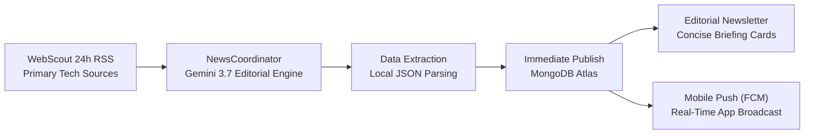
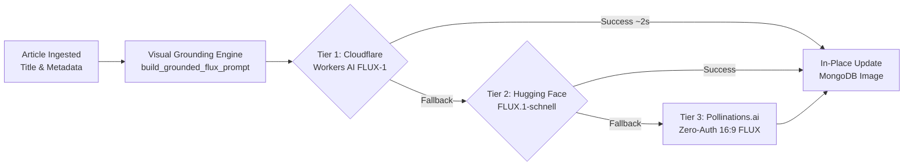
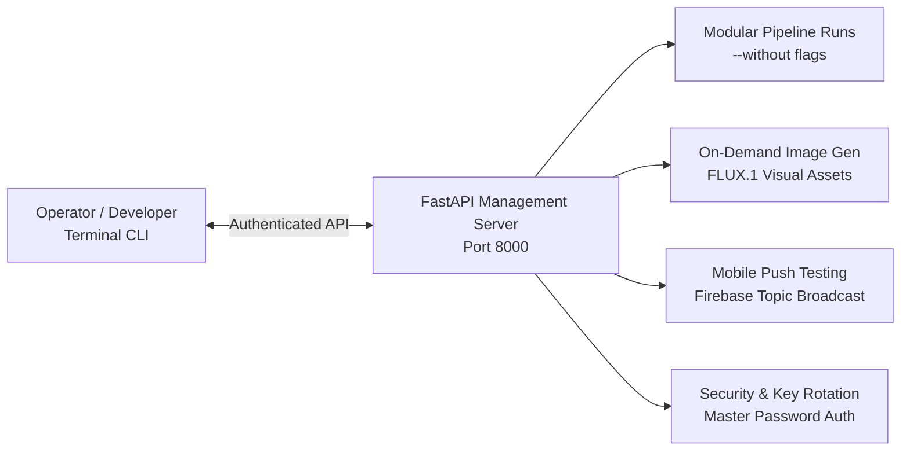

## LucidTrend

An autonomous technology intelligence engine that continuously scouts developer ecosystems, synthesizes high-impact technical analysis from breaking primary sources, generates custom photorealistic visual assets, and delivers clean editorial newsletters into one unified system.

---

## System Overview

### 1. Research and Publishing Pipeline

### 2. High-Precision Image Synthesis Cascade

### 3. Interactive Management & CLI

---

## Autonomous Publishing Schedule

LucidTrend operates on an autonomous 8-slot, 3-hour micro-dispatch cycle synchronized globally. Each slot targets a specific intelligence pillar anchored to international market hours and developer activity cycles.

| Slot | UTC Time | Nepal Time (NPT, UTC+5:45) | Target Category Pillar | Editorial Theme / Focus |
| :---: | :---: | :---: | :--- | :--- |
| **#1** | `00:00 UTC` | **05:45 AM NPT** | **Technology, AI & Research** | Scientific & Security Breakthroughs |
| **#2** | `03:00 UTC` | **08:45 AM NPT** | **Geopolitics & Defense** | Overnight Diplomatic & Strategic Shifts |
| **#3** | `06:00 UTC` | **11:45 AM NPT** | **Finance & Global Markets** | Global, Asian & European Market Intelligence |
| **#4** | `09:00 UTC` | **02:45 PM NPT** | **Technology, AI & Research** | Morning Engineering & Systems Releases |
| **#5** | `12:00 UTC` | **05:45 PM NPT** | **Geopolitics & Defense** | Pre-Market Geopolitical Intelligence |
| **#6** | `15:00 UTC` | **08:45 PM NPT** | **Finance & Global Markets** | Post-Open Market Volatility & Trends |
| **#7** | `18:00 UTC` | **11:45 PM NPT** | **Technology, AI & Research** | Midday Frontier Tech & AI Architecture |
| **#8** | `21:00 UTC` | **02:45 AM NPT** | **Finance & Global Markets** | US Market Close Digest & Macro Movements |

## Detailed Documentation

For in-depth explanations, configuration guides, and complete operational instructions:

* **[Architecture & Mechanism Guide (docs/mechanism.md)](docs/mechanism.md)**: Deep dive into the 2-stage grounded intelligence pipeline, Cloudflare Workers AI FLUX cascade, story-grounded visual prompt engineering, and the Firebase Cloud Messaging mobile push architecture.
* **[User & Operations Guide (docs/use.md)](docs/use.md)**: Step-by-step setup guide for native and Docker environments, `.env` configuration (Cloudflare, Gemini, Mongo, SMTP, Firebase), CLI commands, and REST API documentation.

---

  Developed by <a href="https://www.anamoldhakal.com.np/"><strong>Anamol Dhakal</strong></a>

