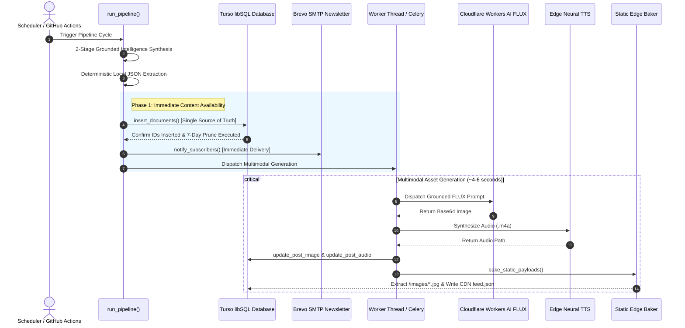
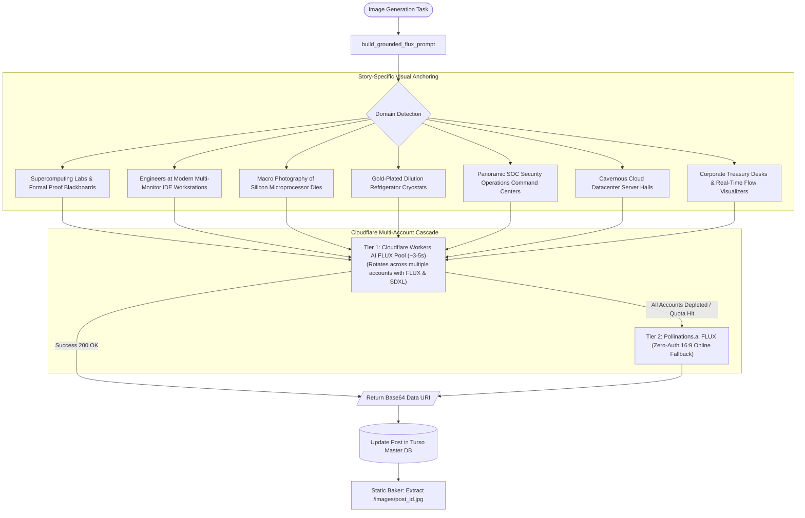
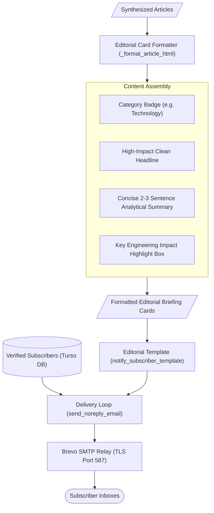

# LucidTrend System Architecture

LucidTrend is an autonomous technology intelligence and publishing system. It continuously scouts global developer ecosystems, synthesizes comprehensive technical articles from breaking primary sources, generates custom photorealistic visual assets, synthesizes audio podcast briefings, updates an edge database, bakes immutable flat CDN payloads, dispatches clean editorial briefings to subscribers, and provides an authenticated command-line interface for interactive control.

This document details the internal mechanics, algorithmic decisions, and communication protocols governing the entire architecture.

---

## 1. End-to-End System Architecture

The LucidTrend ecosystem is divided into autonomous background services, external model inference networks, edge storage engines, delivery channels, and an interactive management layer.

```mermaid
flowchart TD
    subgraph Management ["Interactive Management Layer"]
        CLI["LucidTrend CLI (cli.py)"]
        API["FastAPI Server (:8000)"]
        Auth["API Key Middleware"]
        CLI --> |X-API-Key HTTP Request| Auth
        Auth --> API
    end

    subgraph Orchestration ["Core Scheduler & Pipeline (main.py)"]
        Scheduler["GitHub Actions Schedule (8 Slots / 3h Cycle)"]
        Cleaner["Hourly Temp Directory Cleaner"]
        Runner["Pipeline Orchestrator (run_pipeline)"]
        API --> |Modular Trigger (--with/--without)| Runner
        Scheduler --> |Scheduled Daily Run| Runner
        Cleaner --> |Purges Expired Files| TempDir["temp/ Directory"]
    end

    subgraph Intelligence ["2-Stage Grounded Intelligence Pipeline"]
        WebScout["WebScout RSS Engine (24h Google News Feeds)"]
        NewsCoordinator["NewsCoordinator (Gemini 3.7 Flash)"]
        GeminiPool["Gemini Model Pool & Key Cascading Coordinator"]
        WebScout --> |Verified Real-Time Dossier| NewsCoordinator
        NewsCoordinator --> GeminiPool
    end

    subgraph Extraction ["Deterministic Local Parsing"]
        LocalParser["Zero-Token Fast Extractor (fast_extract)"]
    end

    subgraph Persistence ["Immediate Publishing & Retention Layer"]
        TursoService["Turso libSQL Service (TursoDBService)"]
        TursoDB[("Turso Master DB (posts table)")]
        RetentionJanitor["7-Day Retention Purge Janitor"]
        TursoService --> |1. Insert & Upsert Post| TursoDB
        TursoService --> RetentionJanitor
    end

    subgraph Newsletter ["Editorial Delivery Engine"]
        EmailWorker["Newsletter Dispatcher (send_email_task)"]
        SMTPRelay["SMTP Relay Server (TLS)"]
        Subscribers[("Verified Subscribers (Turso DB)")]
        EmailWorker --> |Fetch Verified Addresses| Subscribers
        EmailWorker --> |Transmit Concise HTML Cards| SMTPRelay
    end

    subgraph Push ["Mobile Push Broadcast Engine (Firebase FCM)"]
        PushWorker["Push Dispatcher (send_push_notification_task)"]
        FCM["Firebase Cloud Messaging (FCM)"]
        MobileDevices[("Mobile App Devices (Topic: all_news)")]
        PushWorker --> |Topic Broadcast Payload| FCM
        FCM --> |Push Alert + Deep Link| MobileDevices
    end

    subgraph Multimodal ["High-Precision Multimodal & Static Edge Layer"]
        AssetWorker["Worker Threads / Celery"]
        VisualDirector["Visual Grounding Engine (build_grounded_flux_prompt)"]
        CF_AI["Tier 1: Cloudflare Workers AI FLUX Pool (Multi-Account)"]
        Pollinations["Tier 2: Pollinations.ai FLUX (Zero-Auth 16:9)"]
        TTS["Microsoft Edge Neural TTS (.m4a Narration)"]
        StaticBaker["Static Edge Baker (Flat CDN Payloads)"]
        EdgeCDN["Vercel Edge CDN (news-pluk)"]
        
        AssetWorker --> VisualDirector
        VisualDirector --> CF_AI
        CF_AI -.->|Fallback| Pollinations
        CF_AI --> TursoDB
        Pollinations --> TursoDB
        AssetWorker --> TTS --> TursoDB
        TursoDB --> StaticBaker --> EdgeCDN
    end
```

---

## 2. Intelligence Synthesis & Free-Tier Resilience

To ensure continuous operation without API billing or quota halts, LucidTrend uses an automated **Model Tier & API Key Cascading Coordinator** (`KeyModelCoordinator`):

```
       [Request Dispatched: Gemini 3.7 Flash / Active Key]
                               |
                   Does Key Hit 429 Quota?
                    /                  \
                 (Yes)                 (No)
                  |                     |
     [Rotate to Next Key in Pool]   [Complete Synthesis]
                  |
         Are All Keys Exhausted?
          /                   \
       (Yes)                  (No)
        |                      |
[Cascade to Next Model Tier]  [Retry with New Key]
(gemini-3.5-flash-lite)
```

### Model Cascade Matrix
| Model Tier | Model Name | Timeout Ceiling | Purpose |
| :---: | :--- | :---: | :--- |
| **Tier 1** | `gemini-3.7-flash` | 75s | Flagship hybrid reasoning, highly detailed technical journalism. |
| **Tier 2** | `gemini-3.5-flash-lite` | 45s | High-throughput low-latency fallback with minimal token overhead. |
| **Tier 3** | `gemini-3.1-flash-lite` | 45s | Resilience safety net for elevated traffic spikes. |
| **Tier 4** | `gemini-flash-latest` | 45s | General-purpose legacy fallback. |
| **Tier 5** | `gemini-flash-lite-latest` | 45s | Terminal zero-cost tier. |

---

## 3. Asynchronous Decoupling Architecture

To ensure immediate frontend availability and rapid email delivery, visual generation and audio narration are decoupled from core article persistence:



---

## 4. High-Precision Image Synthesis & Cloudflare AI Cascade

Rather than relying on generic diffusion prompts that produce abstract floating dots in dark space, LucidTrend utilizes an automated **Visual Grounding Engine** paired with a resilient multi-account cascade:



### Visual Grounding Principles
- **Hardware & Semiconductors**: Macro shots of etched silicon dies, gold wire bonds, and liquid cooling rather than generic digital graphics.
- **Developer Tools & Frameworks**: Software engineers in modern studios with ultra-wide screens displaying actual IDE code syntax, debug consoles, and twilight city views.
- **Mathematical Reasoning & AI**: Modern research laboratories with illuminated formal logic blackboards and operator terminals.
- **Quantum Computing**: Dilution cryostats with gold-plated plates and braided copper wiring in cleanroom environments.
- **Institutional Finance & Crypto**: High-frequency trading command centers, cryptographic lattice telemetries, and dark obsidian interiors.

---

## 5. Concise Editorial Newsletter Architecture

The email distribution subsystem is designed specifically for technical professionals, focusing on clarity, typography, and deliverability.



- **Clean Typography**: Eliminates raw 500-word markdown code dumps and ASCII diagrams from email inboxes while preserving the complete deep-dive content on the website.
- **Key Engineering Impact**: Highlighting critical takeaways, migration hurdles, or benchmark gains in a dedicated callout box.

---

## 6. Real-Time Mobile Push Notification Architecture (Firebase FCM)

To notify mobile readers immediately upon publication, LucidTrend integrates directly with Google Firebase Cloud Messaging (FCM) using the official `firebase-admin` SDK.

```mermaid
flowchart TD
    Publish([New Articles Published to Turso DB]) --> NotifySub[notify_subscribers Pipeline]
    
    NotifySub --> CeleryQueue["Celery Task Queue (send_push_notifications_batch_task)"]
    
    subgraph FCMWorker ["Mobile Push Worker (push_service.py)"]
        InitCheck{Firebase Initialized?}
        LoadKey[Load Service Account Key JSON]
        InitSDK[firebase_admin.initialize_app]
        BuildPayload[Construct High-Priority FCM Message]
        SendFCM[messaging.send(message)]
        
        InitCheck -- No --> LoadKey --> InitSDK --> BuildPayload
        InitCheck -- Yes --> BuildPayload
        BuildPayload --> SendFCM
    end
    
    CeleryQueue --> FCMWorker
    NotifySub -.->|Fallback if Celery Offline| FCMWorker
    
    subgraph TopicBroadcast ["Google FCM Topic Infrastructure"]
        FCMService["Google FCM Gateway"]
        Topic["Topic: 'all_news'"]
        SendFCM --> FCMService --> Topic
    end
    
    subgraph MobileClients ["NewsPluk Mobile Application (iOS / Android)"]
        Capacitor["@capacitor/push-notifications"]
        Channel["Android Channel: 'dispatches' (High Priority)"]
        AppOpen["User Tap -> Deep Links to /{post_id}"]
        
        Topic --> Capacitor
        Capacitor --> Channel
        Channel --> AppOpen
    end
```

### Push Payload Structure
- **Topic**: `all_news` (configurable via `FIREBASE_NOTIFICATION_TOPIC`).
- **Notification Header**: `title: "NewsPluk | New Dispatch Published"`, `body: "<Article Title>"`.
- **Data Attributes**: `id: "<Article ID>"`, `link: "/<Article ID>"` for Capacitor client deep-linking.
- **Android Configuration**: Channel ID `dispatches`, high notification priority, default alert sound.
- **APNS (iOS) Configuration**: Sound enabled, high-priority background delivery payload.
